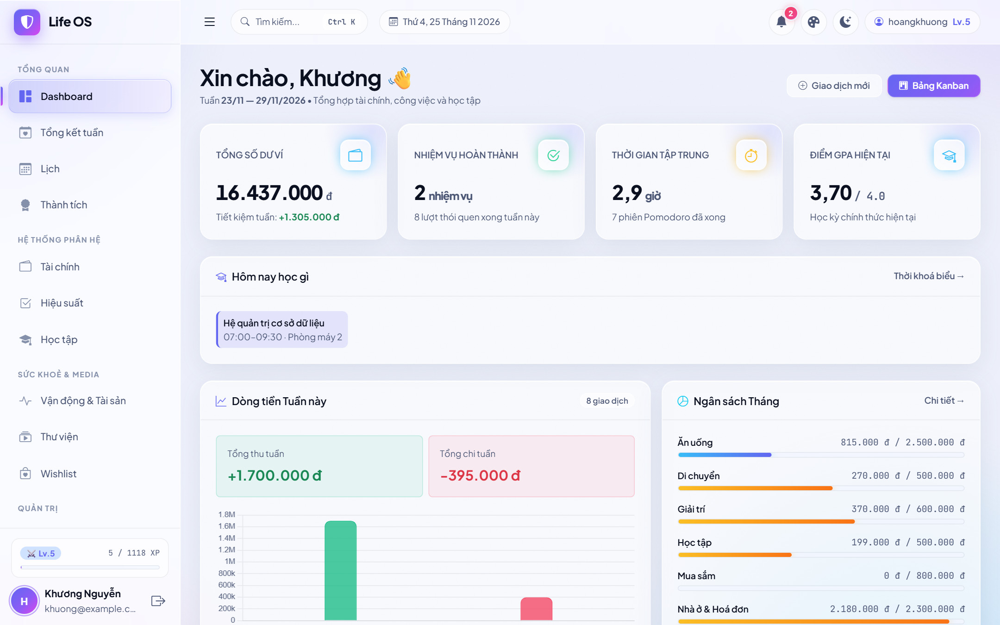
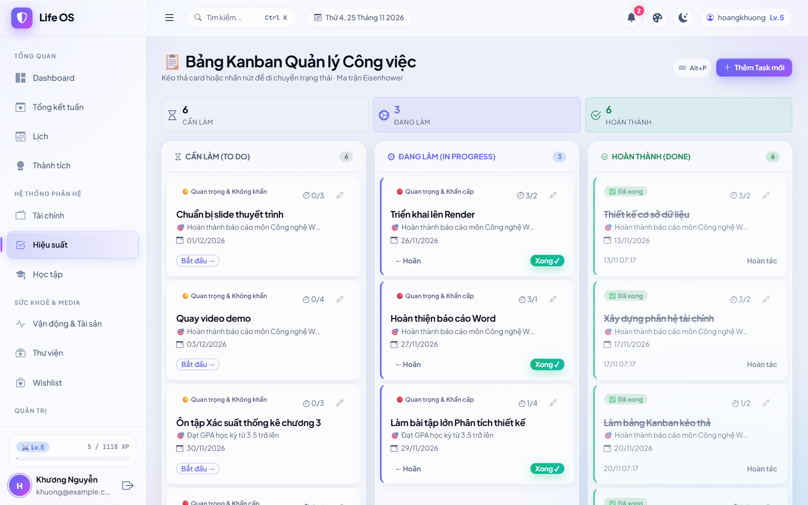
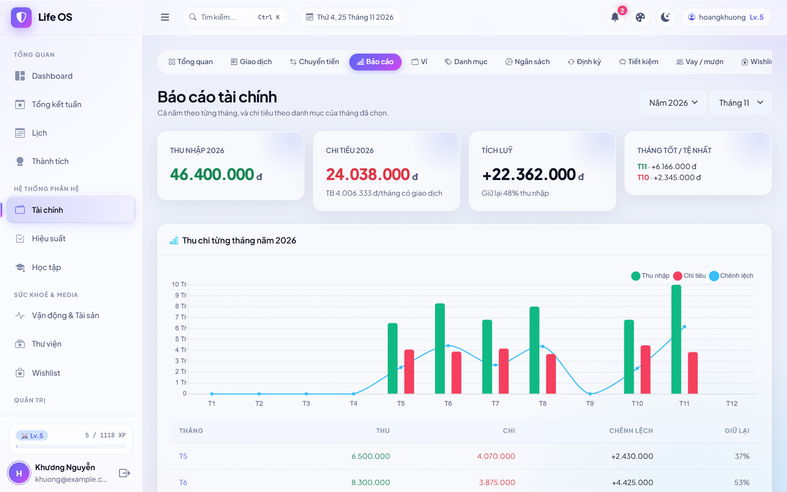
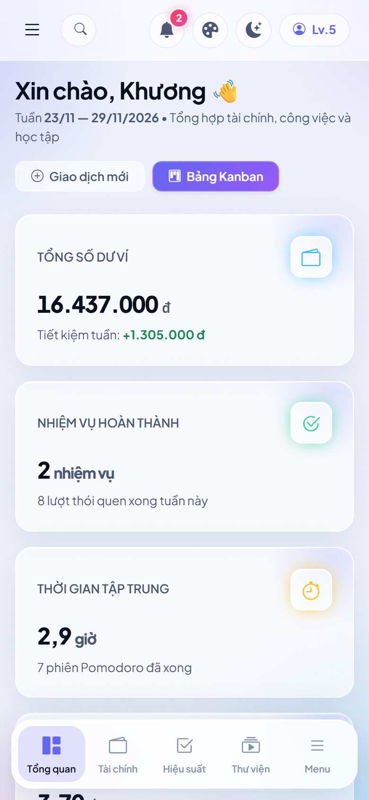

# Life OS

Website quản lý cuộc sống cá nhân "tất cả trong một" cho sinh viên: tiền bạc, công việc, việc học và thư viện sách/phim/game ở cùng một nơi, có XP, cấp độ và huy hiệu để tạo động lực.

- **Dùng thử:** https://lifeos-x43r.onrender.com/ (tự đăng ký tài khoản; web chạy gói miễn phí nên lần mở đầu có thể chờ 30–60 giây)
- **Công nghệ:** Python 3.13, Django 5.2, Bootstrap 5, Chart.js, PostgreSQL (Neon), triển khai trên Render



## Chức năng

| Phân hệ | Chức năng chính |
|---|---|
| **Tổng quan** (`core`) | Dashboard tuần, lịch tổng hợp và đồng bộ lịch `.ics`, tổng kết tuần, tìm kiếm và thêm nhanh bằng `Ctrl+K`, huy hiệu, sao lưu/khôi phục, thông báo đẩy |
| **Tài chính** (`finance`) | Ví, giao dịch kèm ảnh hoá đơn, nhập CSV, chuyển tiền, ngân sách tháng, khoản định kỳ, quỹ tiết kiệm, wishlist, tài sản, vay/mượn và chia hoá đơn, báo cáo thu chi |
| **Năng suất** (`productivity`) | Mục tiêu, bảng Kanban kéo thả, ma trận Eisenhower, task lặp lại, thói quen với bản đồ nhiệt, đồng hồ Pomodoro |
| **Học tập** (`academic`) | Học kỳ, môn học, GPA thang 4, mô phỏng GPA, thời khoá biểu, ghi chú Markdown, kho đoạn code |
| **Thư viện** (`library`) | Sách, phim, series, game: trạng thái, tiến độ, đánh giá, mục tiêu đọc theo năm |

Ngoài ra web cài được lên điện thoại như một ứng dụng (PWA), có chế độ sáng/tối và giao diện responsive.

| Bảng Kanban | Báo cáo thu chi | Trên điện thoại |
|---|---|---|
|  |  |  |

## Chạy trên máy

Cần Python 3.13 và Git. Các lệnh dưới đây viết cho Windows; trên Linux/macOS thay `.venv\Scripts\activate` bằng `source .venv/bin/activate` và `copy` bằng `cp`.

```bash
git clone https://github.com/hoangKhuong55551/self.git
cd self
python -m venv .venv
.venv\Scripts\activate
pip install -r requirements.txt
copy .env.example .env
python manage.py migrate
python manage.py seed_data
python manage.py runserver
```

Mở http://127.0.0.1:8000/ để dùng.

- `.env.example` đặt sẵn chế độ phát triển và để trống `DATABASE_URL`, nên dự án dùng SQLite, không cần cài thêm hệ quản trị cơ sở dữ liệu.
- `seed_data` không bắt buộc: lệnh này tạo tài khoản mẫu `student` / `admin123` cùng một ít dữ liệu, chỉ dùng khi phát triển.

## Kiểm thử

```bash
python manage.py test
```

Dự án có 258 ca kiểm thử tự động (số dư ví, GPA, phân quyền dữ liệu, task lặp lại, nhập CSV...). Mỗi lần chạy dùng cơ sở dữ liệu tạm, không đụng dữ liệu thật. GitHub Actions chạy lại toàn bộ khi có commit mới, trên cả SQLite và PostgreSQL.

## Cấu trúc thư mục

```
config/         Cấu hình dự án, định tuyến gốc
core/           Tài khoản, dashboard, XP và huy hiệu, tìm kiếm, lịch, sao lưu, thông báo đẩy
finance/        Phân hệ tài chính
productivity/   Mục tiêu, task, thói quen, Pomodoro
academic/       Học kỳ, môn học, thời khoá biểu, ghi chú
library/        Thư viện sách, phim, game
templates/      Khung giao diện chung (base.html), Service Worker
static/         CSS, JavaScript, biểu tượng, manifest
```

Mỗi app có `models.py`, `views.py`, `forms.py`, `urls.py`, `services.py` (nghiệp vụ dùng chung) và `tests.py`.

## Triển khai

Web chạy trên Render (gói miễn phí) với cơ sở dữ liệu PostgreSQL trên Neon; mỗi lần đẩy mã lên nhánh `main`, Render tự build và deploy lại. Hướng dẫn từng bước nằm trong [DEPLOY.md](DEPLOY.md).

## Tác giả

Nguyễn Ngọc Hoàng Khương, lớp 24CT1, Khoa Công nghệ Thông tin, Trường Đại học Kiến trúc Đà Nẵng. Đề tài môn Công nghệ Web.
